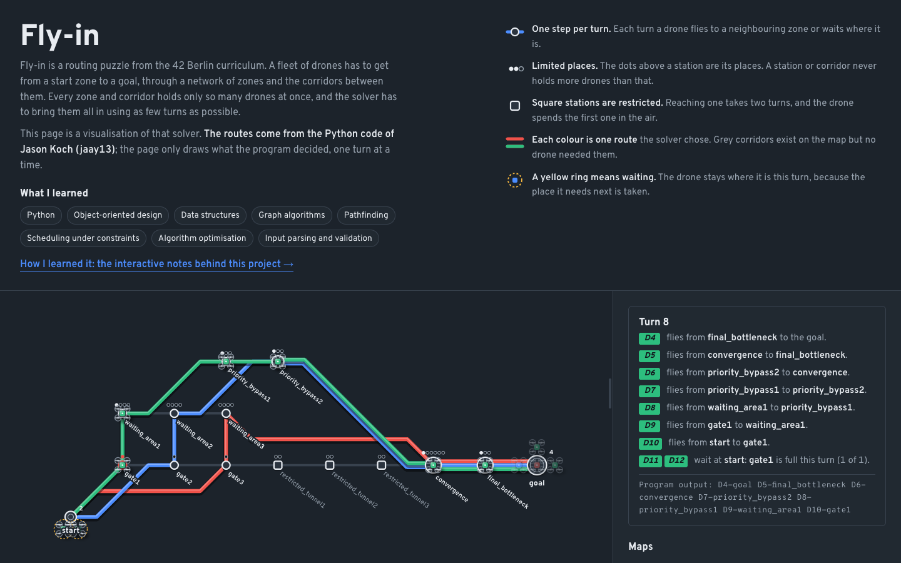
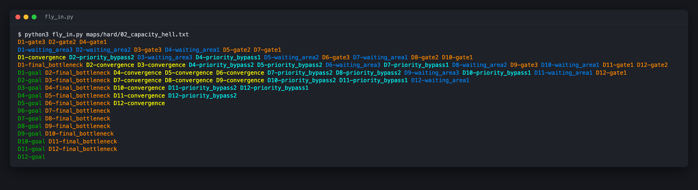
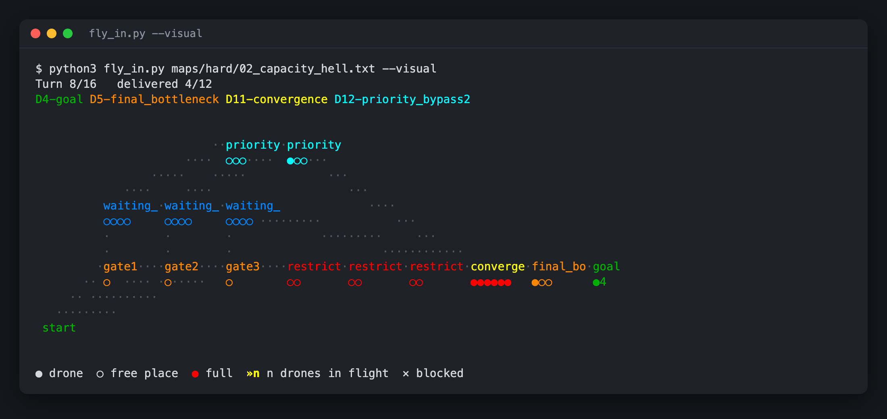
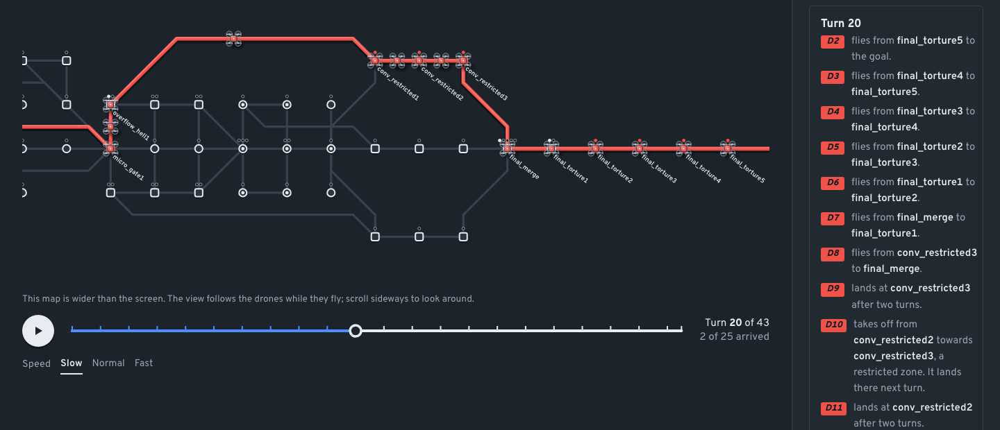

*This project has been created as part of the 42 curriculum by jakoch.*

# Fly-in

## Description

Fly-in routes a fleet of drones from a start hub to an end hub through a
network of zones and connections, in as few simulation turns as possible.

Each map sets the number of drones, the zones with their coordinates and type,
and the connections between them. Zones and connections can only hold a
limited number of drones at the same time. Zone types change how drones move:

| Type | Effect |
|---|---|
| `normal` | entering takes 1 turn |
| `priority` | entering takes 1 turn |
| `restricted` | entering takes 2 turns; the drone is in flight on the connection in between |
| `blocked` | cannot be entered |

The program parses and validates the map, plans a route for every drone
without breaking any capacity, and prints the simulation turn by turn. It
reaches the known optimum on every map that ships with the subject,
including the bonus challenger map (43 turns).

**Live demo:** [fly-in-showcase.vercel.app](https://fly-in-showcase.vercel.app)

[](https://fly-in-showcase.vercel.app)

### What I learned

Python · Object-oriented design · Data structures · Graph algorithms ·
Pathfinding · Scheduling under constraints · Algorithm optimisation ·
Input parsing and validation

## Instructions

Requires Python 3.10 or later.

```bash
make install                        # install flake8, mypy and pytest
make run                            # run the default map
make run MAP=maps/hard/02_capacity_hell.txt
python3 fly_in.py <map_file>        # same thing without make
python3 fly_in.py <map_file> --visual   # animated map in the terminal
```

Other rules:

| Rule | What it does |
|---|---|
| `make debug` | run under `pdb` |
| `make lint` | `flake8` and `mypy` with the flags required by the subject |
| `make lint-strict` | `flake8` and `mypy --strict` |
| `make test` | run the test suite |
| `make clean` | remove `__pycache__`, `.mypy_cache` and `.pytest_cache` |

An invalid map prints `Error: line N: <reason>` to stderr and exits with
status 1. A map where the end cannot be reached prints
`Error: no path from '<start>' to '<end>'` and exits with status 1.

## Algorithm

The program runs in four steps: parse, check, plan, simulate.

1. **Parse.** `MapParser` reads the file line by line into a `Network` of
   `Zone` and `Connection` objects and stops at the first invalid line.
2. **Check.** `Pathfinder` runs a breadth-first search from start to end,
   skipping blocked zones. If the end is unreachable the program stops with
   a clear error instead of searching forever.
3. **Plan.** `Scheduler` plans the drones one after another. Each drone gets
   the earliest-arriving route that still fits around the drones planned
   before it (prioritised planning with a reservation table).
4. **Simulate.** `Simulation` turns the routes into one output line per
   turn.

**Search in space and time.** A search state is `(zone, turn)`, not just a
zone, because a zone that is full at turn 5 may be free at turn 6. From each
state a drone can:

- wait where it is: `(zone, turn + 1)`;
- move to a neighbour: `(neighbour, turn + cost)`, where the cost is 1, or 2
  for a restricted zone. Blocked zones are skipped.

A move is allowed only if the destination zone has a free place on the
arrival turn and the connection has a free place on the turn the drone
leaves on. States sit in a min-heap (`heapq`) ordered by turn, so the first
time the end comes off the heap is the earliest possible arrival (Dijkstra,
where the cost is the turn). Marking a state as visited when it is pushed is
safe, because every path to `(zone, turn)` arrives at the same time.

**Booking calendar.** Two dictionaries count how many drones use each slot:
`zone_use[(zone, turn)]` and `link_use[(connection, turn)]`. After a drone's
route is found, every slot it uses is booked, so later drones see only what
is still free. Start and end zones have no limit.

**Cost.** One search visits at most `zones × turns` states, each pushed once
onto the heap, so planning `D` drones costs about
`O(D · Z · T · log(Z · T))`, where `T` is the last turn. Each drone is planned
once; nothing is recomputed.

**Why this approach.** Planning drones one at a time keeps every search small
and simple, and the calendar guarantees that no capacity is ever broken.
Planning greedily in drone order is not optimal on every possible map, but it
reaches the optimum on all ten maps of the subject:

| Map | Drones | Optimum | Fly-in |
|---|---:|---:|---:|
| easy/01_linear_path | 2 | 4 | 4 |
| easy/02_simple_fork | 4 | 4 | 4 |
| easy/03_basic_capacity | 4 | 4 | 4 |
| medium/01_dead_end_trap | 5 | 8 | 8 |
| medium/02_circular_loop | 6 | 10 | 10 |
| medium/03_priority_puzzle | 5 | 6 | 6 |
| hard/01_maze_nightmare | 8 | 13 | 13 |
| hard/02_capacity_hell | 12 | 16 | 16 |
| hard/03_ultimate_challenge | 15 | 26 | 26 |
| challenger/01_the_impossible_dream | 25 | 43 | 43 |

## Visual representation

**Coloured output.** In a terminal, every move is printed in the colour of
the zone it reaches, taken from the map's `color=` values. Drones that end up
in the same place share a colour, so bottlenecks and parallel routes stand
out at a glance. When the output is piped or redirected it stays plain
text, and unknown colour names are printed without colour.



**`--visual`.** Redraws the map in the terminal every 0.7 seconds, one frame
per turn. Zones sit at their map coordinates. Under each zone, one dot per
place shows how full it is (filled = drone, red = full). `»n` marks drones in
flight to a restricted zone, and `×` marks a blocked zone. The header shows
the turn, the delivered count and that turn's output line. This makes
waiting and queuing visible, which the text output only implies.



**Companion web page.** A separate page,
[fly-in-showcase.vercel.app](https://fly-in-showcase.vercel.app) (repository
`fly-in-showcase`, not part of this submission), draws the same routes as a
transit diagram and
explains every turn in words. It runs this `flyin` package unchanged in the
browser through Pyodide, so you can also edit a map and plan it there.



## Example

Input, `maps/medium/03_priority_puzzle.txt`:

```text
nb_drones: 5

start_hub: start 0 0 [color=green]
hub: slow_path1 1 -1 [zone=restricted color=red]
hub: slow_path2 2 -1 [color=red]
hub: fast_junction 1 0 [zone=priority color=blue max_drones=2]
hub: fast_path 2 0 [zone=priority color=blue]
hub: merge_point 3 0 [color=yellow max_drones=3]
end_hub: goal 4 0 [color=green]

connection: start-slow_path1
connection: start-fast_junction
connection: slow_path1-slow_path2
connection: slow_path2-merge_point
connection: fast_junction-fast_path
connection: fast_path-merge_point
connection: merge_point-goal [max_link_capacity=2]
```

Output, `python3 fly_in.py maps/medium/03_priority_puzzle.txt`:

```text
D1-fast_junction D3-start-slow_path1
D1-fast_path D2-fast_junction D3-slow_path1 D5-start-slow_path1
D1-merge_point D2-fast_path D3-slow_path2 D4-fast_junction D5-slow_path1
D1-goal D2-merge_point D3-merge_point D4-fast_path D5-slow_path2
D2-goal D3-goal D4-merge_point D5-merge_point
D4-goal D5-goal
```

Each line is one turn. `D<id>-<zone>` means the drone reached that zone.
`D<id>-<a>-<b>` means it is in flight on connection `a-b` towards a
restricted zone. Drones that wait or are already delivered are left out.
All 5 drones arrive in 6 turns, the optimum: D3 and D5 take the slow
restricted path so the others don't have to queue for the fast one.

## Resources

- Python documentation: [`heapq`](https://docs.python.org/3/library/heapq.html),
  [`dataclasses`](https://docs.python.org/3/library/dataclasses.html),
  [`enum`](https://docs.python.org/3/library/enum.html)
- [Breadth-first search](https://en.wikipedia.org/wiki/Breadth-first_search)
- [Dijkstra's algorithm](https://en.wikipedia.org/wiki/Dijkstra%27s_algorithm)
- [Multi-agent pathfinding](https://en.wikipedia.org/wiki/Multi-agent_pathfinding),
  in particular cooperative A* with a reservation table
- [mypy documentation](https://mypy.readthedocs.io/)

### AI usage

I used Claude Code (Anthropic) as an engineering tool with a deliberate
setup, not as a code generator. The rule throughout: **I write the logic;
the AI teaches, reviews and takes over the repetitive work.** All parsing,
pathfinding and scheduling logic is my own.

**Setup**

- **Rules file.** A `CLAUDE.md` sets the work split, commit conventions
  and docstring style, so every session follows the same rules without
  being told again.
- **Specialised subagents.** The main session delegates focused jobs to
  custom agents with narrow roles and limited tools, several in parallel.
  Read-only review agents check each finished part before it is committed:
  one for correctness and edge cases, one for design and naming
  (`senior-dev`), and one that runs flake8 and mypy and quizzes me on my own
  code so I can defend it (`42-mentor`). They report findings only; I decide
  what to change and write the fixes.
- **Context across sessions.** Custom `/vault-start` and `/vault-end`
  commands load and save progress in a notes vault, and a checklist marks
  every task as mine or the AI's before work starts.

**What the AI did**

- **Teaching:** interactive step-through pages for BFS versus DFS,
  time-expanded search, the booking calendar and `heapq`, running on this
  project's own code and maps.
- **Reviews:** bugs and edge cases in my code, given as hints, not fixes.
- **Repetitive work:** docstrings, flake8 and mypy fixes, the test suite and
  test maps, and commit messages.
- **Visuals:** the drawing code of the `--visual` terminal map (`MapView`,
  built on my `Simulation.positions`) and the companion web page, including
  the screenshots in this README.

**Verification and traceability**

- Nothing AI-made is taken on trust: changes are checked with the test
  suite, flake8, `mypy --strict` and a run of every map against its known
  optimum; screenshots are taken from the program's real output.
- Authorship is visible in the history: my code is committed on its own,
  and every commit with AI-written lines carries a `Co-Authored-By: Claude`
  trailer, so `git log` shows who wrote what.
